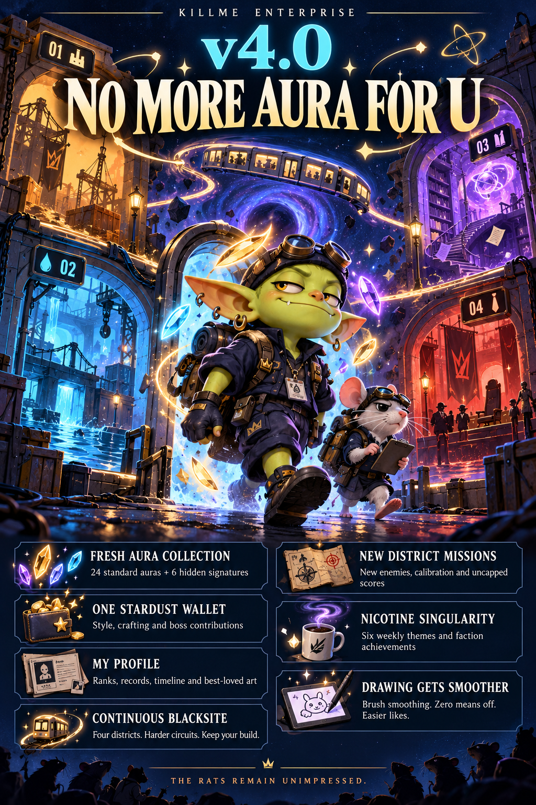

# KILLME ENTERPRISE · v4.0.1

**Archives guardian hotfix.** [Play](https://tuurevvv.github.io/KME-enterprise/?v=4.0.1-archives-hotfix-r1) · [Hotfix details](PATCH-v4.0.1.md)

Fixed the repeatable freeze when summoning Head of Approvals after the Archives evidence mission. Guardians without a special HP override keep their valid, scaled catalogue health. All four real summon paths, the full Archives objective flow, phone rendering, and Mr. Potency’s two stages are checked.

Mossline Yard is marked as the recommended full expedition; unlocked later starts are explicitly fresh-kit advanced shortcuts that skip earlier loot, rather than saved-run resumes. No database migration or collectible reset accompanies this patch. Current hotfix source: src/v401.

## v4.0 main update

**NO MORE AURA FOR U**

[Play the current release](https://tuurevvv.github.io/KME-enterprise/?v=4.0.0-no-more-aura-for-u-r1) · [Full patch notes](PATCH-v4.0.md) · [Design and implementation plan](src/v40/DESIGN-IMPLEMENTATION-PLAN.md)

BLACKSITE now continues through four distinct districts into harder circuits while keeping the whole build. New missions, district enemies, run-resource calibration, sector stardust and uncapped competitive records make every expedition count.

My profile combines collection/style, rank emblems, records, achievements, best-loved art and Journey/activity. Collect 24 standard auras and six hidden signatures with exact normal rarity odds, small duplicate distill yields and visual resonance. Existing cosmetic balances merge into one stardust wallet. Collectible auras restart once; other character data remains.

Nicotine Singularity rotates six weekly themes, awards contributing winners and supports optional stardust donations. Explicit consented reporting earns bounded team credit as described in the patch notes: Night Shift use/resistance, Quitters resistance, five qualifying check-ins per character/device/day. Nicotine quantity or strength never changes the credit.

Drawing gains brush smoothing with exact zero/off and easier likes across chat surfaces. Phone controls, sound settings, reduced motion and original PNG recovery remain supported.

112 isolated check groups passed, including 750 modifier compositions. Scores remain friend-group client reports; physical phones were not manually tested. [Implementation and validation](src/v40/README.md).

Historical release and development notes (superseded by v4.0)

# KILLME ENTERPRISE · v2.9

**quality of nicotine free life update**

Play: https://tuurevvv.github.io/KME-enterprise/

BLACKSITE: Shelter Shift is the permanent 3D main game. Defend a shelter, scavenge eight buildings, buy automatic turrets and combine weapon features into increasingly absurd builds. Original KME bosses, goblins and unlicensed rats inhabit a much larger district. Normal raids have no fifteen-minute cutoff: escalating waves set the limit. Extract before dying to keep the full eligible haul; death and retreat retain only20%.

The separate Rotating Arcade holds shorter crew-voted games. No votes means no forced rotation. The game library preserves individual leaderboards and the rotating cabinet's published history.

“I'm tweaking” opens Drawing Studio and a visible three/five-minute coping timer. Tweakmax remains selectable and runs alongside that timer. Its difficulty escalates every four seconds. Bank a competitive score any time; **Bank & I resisted** records a resistance report only when explicitly requested and nicotine sharing is enabled. The timer is a coping tool, not a medical promise. Losing a minigame never means failing to resist nicotine.

Fullscreen/game mode is below the main game. Desktop: WASD move, mouse aim/fire, **E interact**, R parry, Space dash, Q vent, V infusion, F weapon. Phone: twin sticks and action buttons. The shop uses earned run scrap, never money; combat upgrades reset each raid. Cosmetics confer no permanent power.

Historical patch names: v1.0 **major start**, v1.5 **tweakmax**. Every update has a signature name; see patches.json and the in-app history. Development details are in [ARCADE-DEVELOPER.md](ARCADE-DEVELOPER.md). Readable game sources are under src/blacksite; app.js is the integrated static client.

GitHub Pages serves the client; Supabase stores admitted group data behind explicit guards and RLS. Never commit shared passwords or owner keys. The app is free and intended for actual private friends. No paid loot, betting, trading, cash-outs or real-world prizes. Three.js0.180.0 is vendored locally under MIT; see vendor/THREE-LICENSE.txt. All KME character models are procedural originals.

## v2.1

Shield Lancer charges hit the reactor once on real contact, independent of frame rate. Bongo’s shop now has illustrated weapon/attachment/shelter/supply cards, owned-weapon switching and purchase prerequisites. Mole dirt trails and eruptions, richer attack animations and hazards, and individual named boss health bars make fights readable.

Crew Chat replaces Break Room with no daily message limit, paged messages/replies and respect reactions. Drawing side quests share the coping timer; Done then an explicit outcome posts a tiny drawing. Chat never displays the outcome. Only consented explicit resistance creates a check-in; Not this time creates no use report. The original small-drawing format used 100 images / seven-day / 24 KiB limits; v2.2 replaced that format with full-quality originals. text history caps at 10,000 and chat downloads have a daily protective budget. See the privacy notice and CREW-CHAT.md.

## v2.2

Overview is the Common Room: a shared autosaving text page (made permanent in v2.9), recent chat with visible art and a composer, prominent clock-in controls, compact personal/crew panels and clearer recent events. The fact/workforce panels are removed from Overview.

Drawing Studio is the default quick activity and a permanent Arcade cabinet. It has a 2048 × 1536 canvas, three layers, custom colours, fine brushes, opacity, fill/shapes, zoom/pan, undo/redo and lossless PNG downloads. The subject library contains 263 subjects and 15,780 combinations. Original drawings have no stroke/point/time cap and no old 24 KiB gate: originals upload in resumable verified pieces, while small previews keep the home feed fast. Saved legacy drafts migrate to IndexedDB without truncation. Old gallery files expire to manage storage. See PATCH-v2.2.md and CREW-CHAT.md.

## v2.2.5 layout hotfix

Nicotine support comes first. Phone craving/check-in controls precede social features. Desktop has a support column alongside the shared note and Crew updates. Crew updates combines chat, drawings and recent check-ins, with filters, a composer above the feed and full-width artwork. Phone updates start collapsed without downloading image previews; explicit drawing-to-chat links open them. No migration. See PATCH-v2.2.5.md.

## v2.2.6 roster hotfix

A vertical On shift list shows all characters, live quit timers and the most recent available check-in. A small exclamation marks reports from the last hour. Rank and milestones are an always-visible card directly below nicotine check-ins and above the roster. Games-only characters retain disabled clocks. No migration. See PATCH-v2.2.6.md.

## v2.9 quality update

The shared noticeboard has an editable title and permanent text, with revision checks, recoverable drafts and explicit conflict handling. Crew updates defaults to chat and artwork, includes replies and has refresh/retry controls. Text composers preserve local drafts and idempotent send receipts. Overview has a character banner, clickable character sheets and rotating headlines.

The free wardrobe has 39 items across six slots: name ink, name effect, avatar, motion, frame and banner. Saved art, validated games and explicit consented resistance earn capped cosmetic credit. Purchases and equipped looks are stored on the server and follow the character across devices; there is no trading or combat power.

Chat combines conversation and incident history with phone tabs. Play combines BLACKSITE, the rotating cabinet, Drawing Studio and the boss campaign; records, loot, library, votes and history are expandable. Nicotine support stays ahead of social features on phones.

The website is installable with an optional per-device Web Push subscription: generic crew updates, coping timers and an optional daily reminder. iOS16.4+ requires Home Screen installation; Android requires a compatible browser. Permission is requested only from an explicit button. Private push keys/endpoints and a bounded delivery queue stay on the server. Physical phone delivery must be checked using the built-in test after installation.

Current development build: `node work/v7/build.mjs --pending`, then `node work/v7/package.mjs --pending`. Read src/quality/DEVELOPER.md before changing this layer. Never rebuild with v6 alone.

